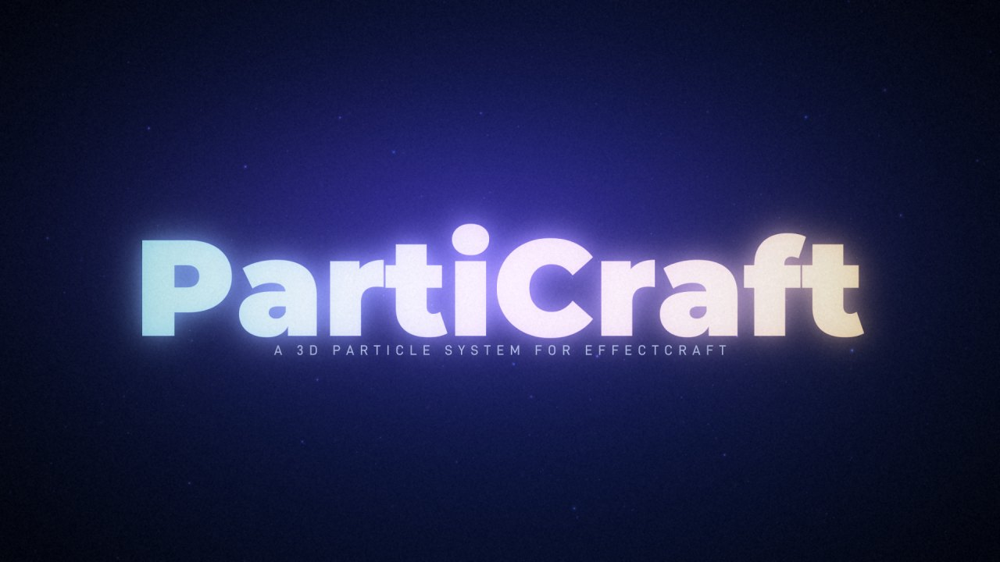

# PartiCraft

[](media/particraft_demo.mp4)

▶ [Watch the feature demo](media/particraft_demo.mp4) (128 s, 720p, with sound): every particle
rendered by PartiCraft in EffectCraft, in an EffectCraft build that also provides the host features
marked † below.

A 3D particle system for [EffectCraft](https://github.com/storytold/effectcraft): emitters, physics,
sprites, lighting and motion blur, as one effect. It runs as a native **effect helper**, a separate
program that EffectCraft starts and renders through. It uses every core and draws tens of thousands
of particles per frame at 1080p in a few milliseconds.

The simulation is deterministic: a frame renders the same whether you scrub, play or render, and
whatever order the frames come in.

## Features

Items marked † use host features that EffectCraft 0.24.1 doesn't offer yet; see
[On EffectCraft 0.24.1](#on-effectcraft-0241) for what they do there.

- **Emitters:** Point, Box, Sphere, Layer (emits from a layer's pixels, takes their colour, and can
  turn their colour into size, velocity or rotation), Light(s)†, Text/Mask outlines or fills, and 3D
  Model (an OBJ file's vertices, edges or faces).
  - Continuous or Explode, with five direction modes.
  - Distribution on a grid, with four sequencing types.
  - Position Subframe, so a fast-moving emitter leaves a smooth trail.
- **Particle types:**
  - Sphere and Glow Sphere, with their own blend modes and Glow Blend Mode.
  - Star and Streaks.
  - Puff (textured smoke).
  - Sprite: any layer, with rotation, Colorize / Fill and 11 time-sampling modes for animated sprites.
- **Look:**
  - Size and opacity over life; colour over life from two colours, or from a gradient†.
  - Colour random.
  - Normal, Add, Screen and Lighten blend modes. Add is truly additive: where particles overlap,
    the light keeps building, so a dense core glows hotter than its edge.
- **Physics:**
  - Gravity, air resistance and wind.
  - Air turbulence (a fractal wind field).
  - **Bounce** off a floor and two walls: Bounce, Slide, Stick or Kill, with friction, and particles
    come to rest. The floor is set by its own controls, or is a comp layer†; the walls are comp
    layers†.
- **Trails system:** trails of secondary particles from each main particle, with their own life,
  size, opacity and colour over life.
- **Comp lights and camera†:**
  - Lighting by the comp's point and spot lights.
  - Self-Shadow (soft self-shadowing for clouds).
  - Drawing through the comp's camera layer, with the camera's depth of field.
- **Motion blur:** for particles and sprites, and for a moving camera†.

148 controls, in 19 groups: Emitter (with 3D Model, Layer Emitter, Distribution), Particle (Sprite,
Rotation, Glow, Streaks), Physics (Air Turbulence, Bounce 1–3), Trails, Lighting, Self-Shadow and
Rendering (Motion Blur). They show as twirl-downs where the host groups them†, as one list otherwise.

## Install

PartiCraft is a native program, so it isn't in EffectCraft's Plug-in Library, which carries
WebAssembly plug-ins only.

1. Download `effectcraft-helper-particraft.exe` (Windows x64) or `effectcraft-helper-particraft`
   (Linux x64) from the [latest release](https://github.com/spoofah/particraft/releases/latest)
   and check it against `SHA256SUMS`.
2. Close EffectCraft and copy the file into the `helpers` folder beside the EffectCraft program
   (or into a folder named in the environment variable `EFFECTCRAFT_HELPER_PATH`). On Linux, make
   it executable: `chmod +x effectcraft-helper-particraft`.
3. Start EffectCraft and choose **Effect ▸ Scan for Effect Helpers**. To start helpers every time
   EffectCraft launches, set the environment variable `EFFECTCRAFT_HELPERS=1`.
4. Apply **Simulation ▸ PartiCraft** to a solid.

Releases have Windows x64 and Linux x64 builds. The Linux build renders the same frames as the
Windows one in EffectCraft's command-line renderer on Ubuntu (under WSL); the Linux desktop app
hasn't been tried yet. On macOS, build it from source (below); that build hasn't been tested.

## On EffectCraft 0.24.1

Everything not marked † works fully in EffectCraft 0.24.1. Three things to know:

- **A layer with nothing animated freezes.** EffectCraft 0.24.1 reuses a layer's frame when none
  of its properties change, so the particles stop on their first frame. Give the layer one thing
  that changes every frame: the expression `time*0.001` on Physics ▸ Air Turbulence ▸ Evolution
  Offset does it without changing the look.
- **Work at 32 bits per channel for dense Add.** At 8 or 16 bits, where many Add particles overlap
  the light clips to white; at 32 bits it keeps its colour and builds smoothly.
- **The † features need more from the host than 0.24.1 gives a helper.** There, PartiCraft falls
  back as follows:

| Feature | On 0.24.1 |
|---|---|
| Drawing through the comp camera, depth of field, camera motion blur | The comp's default view, sharp. |
| Lighting | Off: particles keep their own colours. |
| Light(s) emitter | Emits nothing: there are no lights to emit from. |
| Self-Shadow | Shadows fall away from the viewer instead of from a light named "Shadow". |
| Floor layer and wall layers for Bounce | Floor Position / Rotation / Width / Height place the floor; Bounce 2 and 3 do nothing. |
| A Layer emitter's own position, rotation and scale | It sits at Position; Layer X / Y / Z Rotation and Layer Scale turn and size it. |
| Colour over life from a gradient | From Color to Gradient End Color. |
| Grouped controls | One flat list. |

PartiCraft already supports all of these when a host provides them. EffectCraft is moving to a new
plugin system shared by the Craft apps; PartiCraft will follow it, and the † features will come with
it.

## Build

```bash
cargo test --release
cargo build --release --locked
```

The helper is `target/release/effectcraft-helper-particraft(.exe)`. The toolchain version is in
`rust-toolchain.toml`. Releases are built from the tag by `.github/workflows/release.yml`, so each
asset can be checked against the source.

`cargo run --release --example prof` times the simulation and drawing for each particle type in
process.

## How it works

EffectCraft starts the helper with `--effectcraft-helper` and talks to it over stdin and stdout
(the [effect helper protocol](https://github.com/storytold/effectcraft/blob/main/docs/external-helpers.md)).
Frames pass through a shared exchange file, which the helper maps into memory.

Each layer's particle state is kept between frames. A frame is simulated forward from the nearest
state before it: the 16 most recent states per layer are kept, because EffectCraft renders frames
out of order across its workers. Parameter changes behind the playhead are caught by sampling the
parameter history, so an edit re-simulates from where it takes effect.

Drawing is split into bands of rows over all cores. Where the host asks for it, PartiCraft reports
the rectangle it drew, so only that is composited.

## Licence

MIT or Apache-2.0, at your option.
